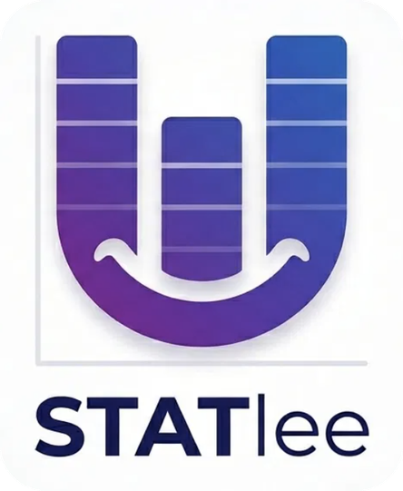
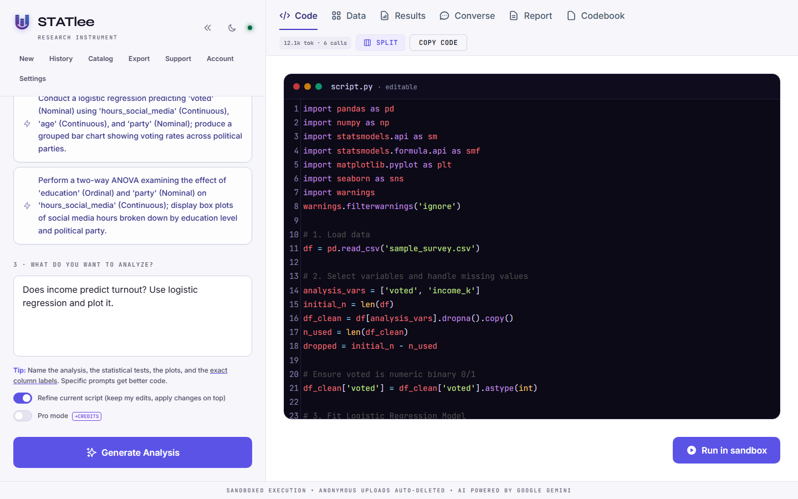
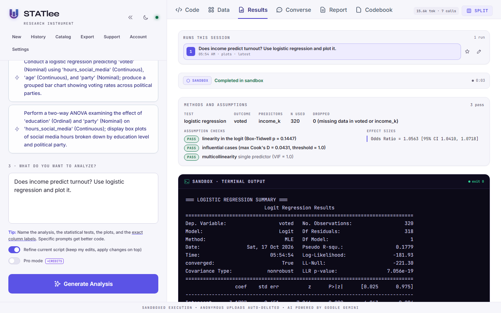
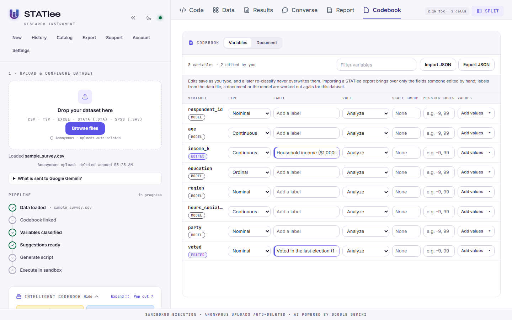
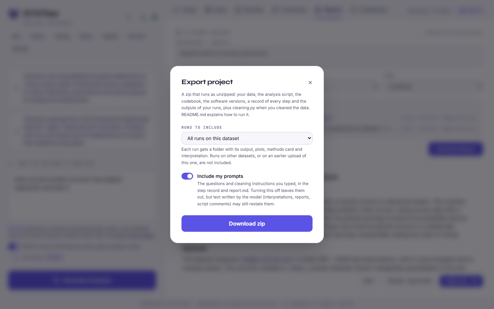
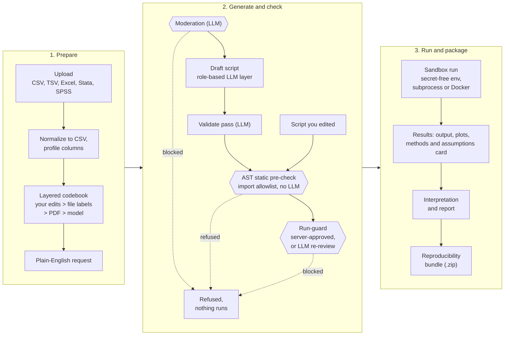
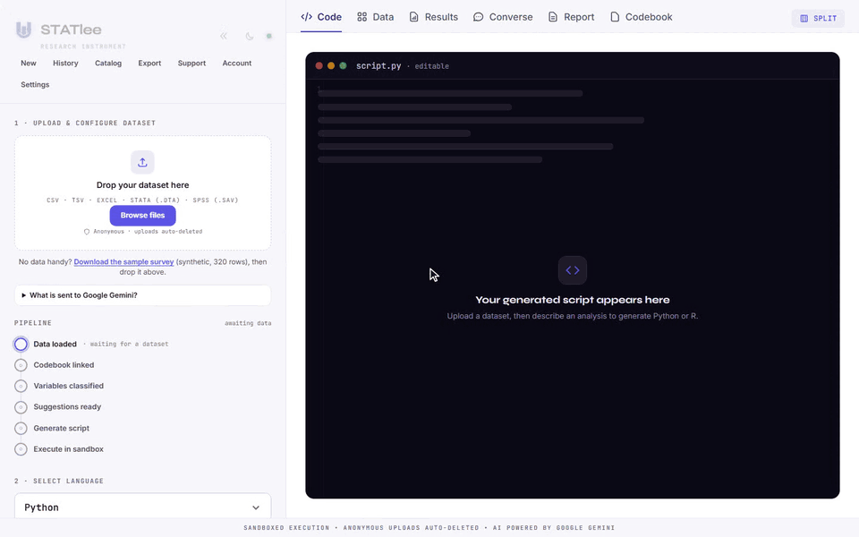

<p align="center">
  
</p>

<h1 align="center">Plain-English statistics for social scientists</h1>

<p align="center">
  Ask a question about your survey data. STATlee has a model write the Python
  or R, checks the script twice, runs it in a sandbox and explains the result.
</p>

<p align="center">
  
  
  <a href="https://github.com/yib7/STATlee/actions/workflows/ci.yml"></a>
  
  
  <a href="LICENSE"></a>
</p>

An LLM writes the analysis code, so the interesting part is what happens before
that code runs:

- A non-LLM AST check (`statlee/codecheck.py`) refuses any Python import outside
  an allowlist, then an LLM run-guard re-reviews any script the server did not
  approve itself.
- The script runs in a throwaway directory with secrets scrubbed from its
  environment and a time limit. `SANDBOX_MODE=docker` gives each run its own
  network-less, read-only, non-root container.
- Every model call goes through one role-based layer (`pro`, `pro_max`, `draft`,
  `flash`, `lite`) over Gemini, Claude or OpenAI. Changing a model or provider
  is a setting, not a code change.
- The export is a zip that runs as unzipped: data, `cleaning.py`, the analysis
  script, per-run outputs, the codebook, and a `provenance.json` with SHA-256
  hashes of what produced what.
- 1,500+ tests run offline against a fake LLM, Playwright browser tests
  included, on Linux and Windows in CI.

## Screenshots

<table>
  <tr>
    <td></td>
    <td></td>
  </tr>
  <tr>
    <td></td>
    <td></td>
  </tr>
</table>

## What it does

- Reads CSV, TSV, Excel, Stata and SPSS files. Value labels in `.sav` and `.dta`
  files seed the codebook.
- Keeps an editable codebook: type, labels, missing codes, and role (ID, survey
  weight, ignore). Your edits outrank file labels, a PDF data dictionary and the
  model's guesses.
- Turns a plain-English request into a script you can read and edit before it
  runs. Pro mode switches code generation to a larger model (`gemini-4-argon`
  by default).
- Keeps every run in a run rail: star, rename, reopen, or pick the runs a report
  is built from.
- Shows a methods and assumptions card per run: test, N, assumption checks and
  effect sizes.
- Cleans data through chat, with undo, redo and a revert to the original upload.
- Writes a plain-English interpretation, a debugging hint when a run fails, and
  a report drafted only from your outputs.

The app is at `/` and a short product page at `/welcome`. The full feature list
is in [docs/README.md](docs/README.md).

## How it works



A freshly drafted script gets both checks before the server approves it. At run
time the static check runs on every script, and the LLM review is skipped only
for the exact script the server approved. The request lifecycle and every module
are in [docs/ARCHITECTURE.md](docs/ARCHITECTURE.md).

## Stack

- Backend: Python 3.11+ (3.12 pinned), Flask, SQLAlchemy with Alembic, SQLite
  or PostgreSQL, Gunicorn.
- Analysis: pandas, statsmodels, matplotlib, seaborn. R in the Docker images.
- Models: the `google-genai`, `anthropic` and `openai` SDKs behind
  `statlee/llm.py`.
- Frontend: vanilla JavaScript, Tailwind CSS, CodeMirror 5, marked with
  DOMPurify, self-hosted fonts.
- Tooling: Docker Compose, hash-locked requirements, pytest with Playwright,
  ruff, pip-audit, GitHub Actions.

## Quickstart

STATlee runs in Docker, so generated analysis code runs inside a container
rather than on your machine.

**You need:**

- [Docker](https://docs.docker.com/get-started/get-docker/) with Compose 2.24 or
  newer, running (Docker Desktop on Windows and macOS; Docker Engine with the
  Compose plugin on Linux).
- An LLM API key. Gemini is the default; get a free key at
  [Google AI Studio](https://aistudio.google.com/apikey).
- Git.

Tested on Linux and Windows. macOS is untested but should work, since
everything runs inside Docker.

**Step 1.** Clone the repository and enter it.

```bash
git clone https://github.com/yib7/STATlee.git
cd STATlee
```

**Step 2.** Create your settings file from the template (`cp` works in
PowerShell too).

```bash
cp .env.example .env
```

**Step 3.** Open `.env` in any text editor and replace `your_api_key_here`
with your Gemini key.

```env
GEMINI_API_KEY=your_api_key_here
```

**Step 4.** Build and start STATlee. The first build installs R and the
analysis libraries into the image and takes a few minutes.

```bash
docker compose up --build
```

**Step 5.** Open <http://localhost:5000>, click **Download the sample survey**
under the upload box, and drop the file into the box to run a first analysis.

**Next time,** start it from the same folder with one command, and stop it
with `Ctrl+C`. The database and uploads live in the `statlee-instance` Docker
volume, so they survive restarts and rebuilds.

```bash
docker compose up
```

After pulling new code, run `docker compose up --build` once to rebuild.

### Use Claude or OpenAI instead (optional)

Skip this if you use Gemini. Set `LLM_PROVIDER` and that vendor's key in
`.env`, then restart with `docker compose up`.

| `LLM_PROVIDER` | Key in `.env` | Get a key | Notes |
|---|---|---|---|
| `gemini` *(default)* | `GEMINI_API_KEY` | [Google AI Studio](https://aistudio.google.com/apikey) | PDF codebooks and chart reading work with all three providers. |
| `anthropic` | `ANTHROPIC_API_KEY` | [Anthropic Console](https://console.anthropic.com/) | Claude models; also accepts a local OAuth/subscription login for keyless dev. |
| `openai` | `OPENAI_API_KEY` | [OpenAI Platform](https://platform.openai.com/api-keys) | GPT models. |

Each role's model is chosen per provider and can be pinned with `MODEL_PRO`,
`MODEL_PRO_MAX`, `MODEL_FLASH` and `MODEL_FLASH_LITE`.
[`.env.example`](.env.example) documents every setting, including the monthly
spend ceiling and the password lock. [docs/README.md](docs/README.md) covers
the Docker sandbox mode and PostgreSQL.

## Development

For contributors. This runs the app directly on your machine, where generated
code runs on your host with no container around it, so use it for development
only.

**You need:** Python 3.11 or newer (3.12 is pinned in `.python-version`) and a
clone of the repository (Quickstart Step 1). No API key: the tests use a
deterministic fake LLM and run offline.

**Step 1.** Create and activate a virtual environment in the repository folder.

```bash
python -m venv venv
source venv/bin/activate        # Windows: venv\Scripts\activate
```

**Step 2.** Install the locked dependencies (app, test and lint tools).

```bash
pip install -r requirements/dev.lock
```

**Step 3.** Run the tests and the linter.

```bash
python -m pytest
python -m ruff check .
```

**Step 4.** Start the development server at <http://localhost:5000>. It boots
without a key; add one to `.env` (Quickstart Steps 2 and 3) when you want live
model calls.

```bash
python wsgi.py
```

**Optional extras:**

- **Browser tests** (skip unless you change the UI; they skip themselves when
  Chromium is missing): `python -m playwright install chromium`.
- **R** (skip unless you work on R analyses): R scripts run with `Rscript` from
  your PATH. Without it, Python analyses work as usual and an R run reports
  "Interpreter not available". The Docker images include R.
- **Node.js** (only to rebuild the committed Tailwind CSS after changing
  classes): see "Styles" in [docs/ARCHITECTURE.md](docs/ARCHITECTURE.md).

Dependencies are pinned and hashed in `requirements/*.lock`, compiled from the
hand-edited `requirements/*.txt`; the regeneration commands are at the top of
`requirements/base.txt`. CI runs ruff, pytest on Linux and Windows, pip-audit,
both Docker images and these README steps on every push
(`.github/workflows/ci.yml`).

## Demo

<p align="center">
  
</p>

The run uses [docs/examples/sample_survey.csv](docs/examples/sample_survey.csv),
a synthetic 320-row survey, with the default models (Pro mode off). Waits on the
model are sped up in the recording.

## Limitations

- Self-host only. There is no hosted service or public demo.
- It does not replace a statistician. Review the generated code and results;
  the methods card is only as complete as what the script printed.
- The default `SANDBOX_MODE=subprocess` is not kernel isolation: the script
  shares the network and filesystem of wherever the app runs, so the two checks
  are the boundary. Docker mode isolates each run, but needs the Docker CLI where
  the app runs (the shipped Compose setup uses subprocess mode inside the app
  container).
- No survey weighting or APA tables yet. R scripts are checked by a regex
  denylist only, which is best effort.
- Tested on Linux and Windows; macOS is untested.

Next on the list: survey weights, APA tables with `.docx` export, a Likert and
scale toolkit, and Docker as the default sandbox for production.

## Security

- Rate limits are keyed per account or client IP, so clearing cookies does not
  reset them. A monthly ceiling on premium model calls (`.env.example` sets
  200) applies with billing on or off.
- CSRF uses a double-submit token, and responses carry a strict
  Content-Security-Policy plus the usual hardening headers.
- The schema is versioned with Alembic, so an existing database upgrades at boot.

What leaves the server:

- Model calls go to the one provider you configure. They carry your question,
  column names, summary statistics, a few sample values from the first rows,
  the generated script and its output, chart images for interpretation, and any
  codebook PDF you upload.
- Email goes out only when `SMTP_HOST` is set: verification and reset links,
  and issue reports to `ISSUE_REPORT_TO`.
- No analytics or telemetry. Fonts are served by the app, so a page view
  contacts no other host.

To report a vulnerability, see [SECURITY.md](.github/SECURITY.md).

## Docs

- [docs/README.md](docs/README.md): full feature list, settings, Docker sandbox
  mode, PostgreSQL, hosting.
- [docs/ARCHITECTURE.md](docs/ARCHITECTURE.md): request lifecycle, analysis
  pipeline, sandbox, module map.
- [docs/PRICING.md](docs/PRICING.md): the illustrative pricing model and the
  billing seam (billing is off by default).
- [docs/CREDITS.md](docs/CREDITS.md): third-party libraries, licenses and
  provider terms.
- [CHANGELOG.md](CHANGELOG.md): release notes.

## License

Source-available under the [Elastic License 2.0](LICENSE). You can use, modify
and self-host it, but not offer it to third parties as a hosted or managed
service. Model calls are subject to your provider's terms (Gemini by default;
see [CREDITS.md](docs/CREDITS.md)), which the moderation gate enforces.
